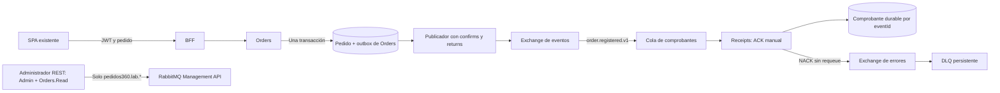

# Pedidos360 — Implementación RabbitMQ, EP3

Fecha del trabajo: 20 de octubre de 2026, zona America/Santiago. Algunas trazas usan UTC y aparecen fechadas el 21 de octubre.

**Entregable principal:** [EP3_RABBITMQ_EVIDENCIAS.pdf](EP3_RABBITMQ_EVIDENCIAS.pdf). Este Markdown conserva el detalle técnico y la reproducibilidad. React está autorizado por el docente. El índice de capturas se mantiene en su ruta original [CAPTURAS_PENDIENTES.md](evidence/ep3/CAPTURAS_PENDIENTES.md), ahora como registro de evidencias completadas.

## 1. Objetivo y punto de partida

Incorporé una tarea asíncrona al registro de pedidos: generar un **comprobante interno de recepción**, almacenado como documento JSON durable. No es una factura, no cobra ni reserva stock. Conservé Catalog, Orders, BFF, sus DTO REST, los snapshots de precios, el propietario del pedido y el frontend existente.

Leí la especificación adjunta completa y contrasté los ocho indicadores con `EP3_DSY1107_Estudiante_encargo.pdf`. Revisé también las guías original, corregida e ilustrada. La pauta conserva ocho pesos: 12, 13, 10, 15, 20, 13, 10 y 7 por ciento. Los ejemplos de clúster, nombres y librerías de las guías no los traté como arquitectura obligatoria.

Trabajé y ejecuté los builds/pruebas dentro de WSL2 con el usuario Linux `codex`. El puerto 8181 ya pertenecía a un contenedor ajeno, por lo que usé 19180–19184 para esta demo. No detuve ese contenedor ni cambié sus puertos. El usuario indicó que AWS estaba activo; no ejecuté operaciones AWS ni desplegué esta EP3 en EC2/RDS. Las configuraciones cloud y Entra anteriores continúan en el código.

## 2. Decisiones de arquitectura

Elegí **Orders → outbox MySQL → RabbitMQ → Receipts**. La operación principal confirma el pedido y el evento en la misma transacción. El envío al broker ocurre después, mediante un publicador periódico. Así, la indisponibilidad de RabbitMQ no convierte un pedido persistido en un error ni pierde la intención de notificar.

Agregué dos aplicaciones desplegables: `receipts-service` y `rabbit-admin-service`. Agregué `messaging-support` como biblioteca técnica de transporte/configuración, no como servicio ni common-domain. No exporta Product, Order, agregados, repositorios ni entidades JPA. `contracts/` contiene JSON Schema y OpenAPI técnicos.

Usé un broker **RabbitMQ 4.2.9**, imagen management fijada por digest, un vhost propio, volumen/red propios y puertos enlazados solo a 127.0.0.1. Elegí un único nodo con colas classic durables por el alcance de esta evaluación y los recursos compartidos del equipo. No afirmo réplica, alta disponibilidad ni tolerancia a pérdida física. No implementé clúster; T04 es no aplicable. Una lista de direcciones del cliente tampoco habría demostrado balanceo.



No incorporé correo externo, pagos, Kubernetes, otro servidor MySQL ni infraestructura AWS nueva. La tarea asíncrona queda visible mediante archivos, endpoint administrativo y logs correlacionados.

## 3. Cambios y contratos

La fuente de nombres es [`pedidos-rabbit.properties`](../messaging-support/src/main/resources/pedidos-rabbit.properties), con declaraciones explícitas en [`MessagingConfiguration`](../messaging-support/src/main/java/cl/duoc/pedidos360/messaging/MessagingConfiguration.java).

| Recurso | Nombre |
|---|---|
| Exchange direct durable | `pedidos360.orders.events.v1` |
| Routing key | `order.registered.v1` |
| Cola durable | `pedidos360.receipts.order-registered.v1` |
| Dead-letter exchange direct | `pedidos360.receipts.errors.v1` |
| Routing key de error | `receipt.failed.v1` |
| DLQ durable | `pedidos360.receipts.failed.v1` |

[`OrderRegisteredV1`](../messaging-support/src/main/java/cl/duoc/pedidos360/messaging/OrderRegisteredV1.java) lleva versión, eventId, orderId, tenantId, fecha, total, moneda y número de líneas. No lleva el JWT, correo, nombre de usuario ni owner oid. El consumidor deserializa un tipo explícito y valida el contrato, en vez de confiar en cabeceras que seleccionen clases Java arbitrarias. El contrato está documentado en [`order-registered-v1.schema.json`](../contracts/order-registered-v1.schema.json).

La migración aditiva [`V2__order_event_outbox.sql`](../orders-service/src/main/resources/db/migration/V2__order_event_outbox.sql) crea una tabla propia de Orders; no cambia ni borra pedidos/líneas. `OrderPersistence` invoca el puerto `OrderEventRecorder` dentro de su transacción. `OutboxRecorder` implementa ese puerto. No hay llamada AMQP dentro del agregado ni de la creación transaccional.

`OutboxPublisher` reclama filas con `FOR UPDATE SKIP LOCKED`, publica mensajes persistentes y espera publisher confirm y ausencia de return. Solo entonces marca published_at. Una publicación no confirmada permanece pendiente con una demora de cinco segundos y un código de error sin contenido sensible. Esta política de publicación pendiente es diferente de los tres intentos de procesamiento del consumidor.

La mensajería de Orders está desactivada por defecto. El perfil `ep3` la habilita y activa su health check Rabbit; los arranques anteriores no requieren broker por incorporar la dependencia.

## 4. Procesamiento, ACK/NACK y errores

`ReceiptListener` usa `@RabbitListener` con `ackMode=MANUAL`, prefetch 1 y un consumidor. Después de guardar el documento, ejecuta `basicAck(tag,false)`. `FileReceiptStore` escribe un temporal, fuerza su contenido a disco, lo mueve atómicamente y sincroniza el directorio antes de devolver éxito.

| Caso | Decisión que implementé | Evidencia ejecutada |
|---|---|---|
| Éxito | Persistir comprobante, luego ACK | `ACK ... result=RECEIPT_STORED` y archivo consultable |
| Mismo eventId y contenido | Conservar un solo efecto, ACK del duplicado | `result=DUPLICATE`; lectura tras reconstruir el store |
| JSON inválido, contrato o messageId inválido | NACK inmediato con multiple=false/requeue=false | DLQ con `x-death.reason=rejected` |
| Error transitorio de almacenamiento | Máximo tres intentos, separación de un segundo | Directorio bloqueador controlado; RETRY y ACK al recuperarse |
| Error transitorio agotado | NACK sin requeue después del tercer intento | `RETRY_EXHAUSTED attempts=3`, mensaje en DLQ |
| eventId reutilizado con otro contenido | Error permanente, conservar documento original, NACK | `PERMANENT_PROCESSING_ERROR` |
| Fallo de transporte al emitir ACK | Propagar el fallo; no confundirlo con error de negocio | Test `ackFailureIsNotMistakenForProcessingFailure` |

El reintento está acotado dentro de la misma entrega; durante la espera puede quedar un mensaje Unacked. No uso un ciclo infinito de `requeue=true`. La razón detallada queda en logs con eventId/orderId y la DLQ conserva la razón AMQP `rejected`. No imprimo el payload completo como log de error.

Mi garantía es publicación/entrega con posibilidad de duplicados y un efecto idempotente por eventId en el store local de un solo escritor. No afirmo exactamente una vez. La DLX de una cola classic no tiene por sí sola la garantía adicional de dead-lettering at-least-once de ciertas configuraciones quorum; el reinicio local demostrado no elimina esa limitación. Para varios consumidores distribuidos usaría un inbox con restricción única en persistencia compartida.

## 5. Administración REST y seguridad

[`RabbitAdminController`](../rabbit-admin-service/src/main/java/cl/duoc/pedidos360/rabbitadmin/api/RabbitAdminController.java) delega en [`RabbitAdminService`](../rabbit-admin-service/src/main/java/cl/duoc/pedidos360/rabbitadmin/application/RabbitAdminService.java). El controlador no conoce la API interna del broker. Elegí su HTTP Management API para consultar recursos y distinguir inexistencia/conflicto de una operación exitosa; las declaraciones de topología del negocio siguen siendo beans AMQP.

| Operación | Ruta relativa a `/api/v1/rabbit` | Respuestas acreditadas |
|---|---|---|
| Crear/consultar/eliminar cola | POST `/queues`, GET/DELETE `/queues/{name}` | 201, 200, 204, 400, 403, 404, 409 |
| Crear/consultar/eliminar exchange | POST `/exchanges`, GET/DELETE `/exchanges/{name}` | 201, 200, 204, 400, 409 |
| Crear/consultar/eliminar binding | POST/DELETE `/bindings` con DTO; GET `/bindings/{exchange}/{queue}` | 201, 200, 204, 400, 404 |
| Broker caído | Operación permitida contra Management | 503, sin falso éxito |

Validé nombres, booleanos obligatorios, tipos direct/topic/fanout, routing key y límites TTL/maxLength. Una declaración equivalente devuelve 200; una nueva, 201. Un cambio incompatible devuelve 409: no pretendo transformar el tipo o los argumentos de una cola existente. Para cambiar una ruta, puedo crear un recurso/binding nuevo y retirar el anterior cuando sea seguro.

La API permite únicamente nombres `pedidos360.lab.*`; rechaza recursos críticos del negocio con 403. El broker confirma que una cola esté vacía y sin consumidores antes de eliminarla. No expuse purge. Las pruebas crean y eliminan solo sus recursos nuevos de laboratorio.

Los dos servicios nuevos validan firma, issuer, audience, tid, azp, versión y vigencia del JWT. Exigen **Admin y Orders.Read**, no una de las dos condiciones. La consulta de comprobantes filtra por tenant. Usé los permisos existentes, sin crear scopes o asignaciones Entra. Probé 401 y 403 con JWT RSA del fixture local; eso no acredita un login real de Microsoft en esta etapa.

## 6. Entorno y comandos usados

La demo usa WSL `codex`, Java 25, Maven Wrapper 3.9.16 y Node 24.20.0 privado. Node 22/Maven 3.9.12 estaban en el PATH inicial; no reemplacé globalmente esos programas. Instalé Node con SHA-256 verificado mediante el procedimiento que dejé en `ep3-toolchain.sh`.

Los targets anteriores de otro usuario no permitían sobrescritura. Por eso añadí el perfil Maven `native-wsl-output` y compilé en `~/.cache/pedidos360-ep3/build`. Copié las fuentes frontend para build en `~/.cache/pedidos360-ep3/frontend`; no moví el workspace. El primer `npm ci` directo también falló por permisos y la instalación posterior en esa copia privada fue exitosa.

```powershell
wsl -d Ubuntu -u codex
```

```bash
cd /mnt/c/Users/Benja/Documents/cloudnative/ev1/pedidos360-backend
bash scripts/ep3-toolchain.sh
bash scripts/ep3.sh setup
bash scripts/ep3.sh broker up -d --wait
bash scripts/ep3.sh configure-broker
bash scripts/ep3-build.sh all
bash scripts/ep3.sh start local
export PATH="$HOME/.local/share/pedidos360-ep3/node/bin:$PATH"
python3 scripts/verify-ep3.py --restart-broker
bash scripts/ep3.sh status
```

`setup` reutiliza las cuatro credenciales existentes de aplicación/migración del contenedor MySQL de Pedidos360. No rota ni cambia esos usuarios. Genera credenciales Rabbit nuevas fuera de Git y separa productor, consumidor y administrador. El runtime carga por proceso la configuración correspondiente. No usé sudo ni la contraseña temporal suministrada.

| Componente | Dirección de la demo |
|---|---|
| SPA | `http://localhost:5173` |
| BFF | `http://127.0.0.1:19180` |
| Catalog / Orders | `127.0.0.1:19181` / `127.0.0.1:19182` |
| Receipts / administrador | `127.0.0.1:19183` / `127.0.0.1:19184` |
| Rabbit AMQP / Management | `127.0.0.1:5672` / `http://localhost:15672` |
| MySQL existente | `127.0.0.1:13306` |

Para detener solo los procesos propios: `bash scripts/ep3.sh stop`. Para detener el broker propio conservando el volumen: `bash scripts/ep3.sh broker stop rabbitmq`. El wrapper rechaza las opciones de borrado de volúmenes. No usé prune ni down -v.

## 7. Pruebas realmente ejecutadas

| Prueba | Resultado y evidencia |
|---|---|
| T01 backend | `clean verify` mediante `ep3-build.sh`: 23 tests Java, cero fallos/errores/omitidos. Incluye los 13 anteriores, outbox/rollback, ACK/NACK y RabbitMQ/MySQL reales con Testcontainers. [Log](evidence/ep3/backend-verify.txt) |
| T02 frontend | `npm ci`, 10 tests y build TypeScript/Vite aprobados en WSL codex. [Instalación](evidence/ep3/frontend-install.txt), [tests](evidence/ep3/frontend-tests.txt), [build](evidence/ep3/frontend-build.txt) |
| T03 | Cinco servicios Spring saludables, broker aislado y frontend iniciado; [contenedores antes](evidence/ep3/containers-before.jsonl) y [después](evidence/ep3/containers-after.json). Los IDs y estados previos se conservaron. |
| T04 | No aplicable: implementé un único nodo; no presento cluster_status como clúster multinodo. |
| T05–T12 | Topología, flujo firmado, duplicado, DLQ, recuperación transitoria, agotamiento, REST y autorización aprobados. [15 grupos de aceptación](evidence/ep3/runtime-checks.txt), [JSON y HTTP exactos](evidence/ep3/runtime-verification.json) |
| T13 | Detuve/inicié solo Rabbit EP3. Un pedido obtuvo 201 con broker caído, quedó pendiente en outbox y fue procesado al volver. El mismo contenedor/volumen conservó la DLQ. [Traza](evidence/ep3/controlled-broker-restart.txt) |
| T14 | Revisión local de código, sintaxis, configuración, valores privados conocidos y enlaces: [resultado final](evidence/ep3/quality-final.json). Destinos exclusivos: chashmdai/pedidos360-backend y chashmdai/pedidos360-frontend. |

La aceptación comprueba que los pedidos/líneas previos conservan sus hashes y el catálogo no cambió. Cada ejecución completa agrega dos pedidos identificables; no borra los datos anteriores. Los mensajes de fallo son inyecciones diagnósticas sobre contratos del pedido de prueba, no pedidos ficticios presentados como acciones nuevas del usuario.

Registré **48 aserciones HTTP** en los 15 grupos, todas con el código esperado. Volví a verificar el aislamiento de los cuatro usuarios MySQL existentes: aplicación y migración acceden solo a su esquema; las aplicaciones no pueden ejecutar DDL ([resultado](evidence/ep3/mysql-isolation.txt)). El diff del frontend está vacío y el SHA-256 de `src/style.css` sigue siendo `ad493558ad25d8e428fcb7732646307727c8bceb358118688cf2b08a4bce24cc`. Desde Windows obtuve HTTP 200 para la SPA, Management y los cinco health checks finales ([comprobación](evidence/ep3/host-access-final.txt)).

## 8. Evidencias y capturas

Conservé trazas reales: [topología](evidence/ep3/topology.json), [DLQ y x-death](evidence/ep3/dead-letter-messages.json), [productor](evidence/ep3/orders-service.txt), [consumidor](evidence/ep3/receipts-service.txt), [administrador](evidence/ep3/rabbit-admin-service.txt) y el JSON de aceptación con métodos/rutas/códigos sin cabeceras Authorization.

El [estado final consultado](evidence/ep3/final-topology.json) registra doce mensajes diagnósticos conservados en la DLQ tras las ejecuciones de aceptación. No son doce pedidos fallidos. La [observación de entrega](evidence/ep3/delivery-observation.json) acredita Ready, Unacked durante reintento y ACK tras recuperar almacenamiento; detuve y reanudé solamente Receipts y restauré su demora original.

Completé las capturas con Chromium/Playwright desde WSL y el navegador integrado para Entra. El [manifiesto](evidence/ep3/captures.json) registra fuente, fecha y SHA-256. Las vistas de TXT/JSON están expresamente identificadas como evidencia ejecutada, no como terminales o pantallas Management simuladas. Conservo también capturas directas de la SPA y del broker. El PDF usa recortes de detalle para legibilidad, sin cambiar los originales.

La [prueba Entra real](evidence/ep3/entra-verification.json) acredita login DUOC/MFA manual, rol User, tres scopes, catálogo 200, pedido 201 y consulta tras recarga 200, publicación confirmada, comprobante y ACK, Admin 403 y renovación solicitada/aceptada. [Logout y ruta protegida](evidence/ep3/entra-browser-close.json) se verificaron desde la UI. No leí/exporté tokens ni almacenamiento de sesión ni hice escrituras Entra. El formulario de la captura 19 corresponde al envío; el resultado se demuestra mediante access logs y correlación de evento. La captura 20 muestra pedidos previos conservados, no la tarjeta del pedido nuevo.

## 9. Matriz trazable de los ocho indicadores

Los porcentajes son los pesos oficiales; no representan una nota obtenida. Las ocho filas cuentan con código, pruebas y evidencia visual; el PDF las resume y el manifiesto conserva las capturas originales.

| N.º / indicador | Peso | Archivos/clases | Tests ejecutados | Evidencia / captura | Estado y deuda |
|---|---:|---|---|---|---|
| 1. Nombres centralizados | 12% | `pedidos-rabbit.properties`, `MessagingProperties` | T05 | Capturas 04/05 y `pdf-topology.png` | Verificado |
| 2. Beans Queue/Exchange/Binding | 13% | `MessagingConfiguration` | T05, integración Rabbit real | Capturas 05b/05c; tests Java | Verificado |
| 3. Configuración separada | 10% | `OrderMessagingConfiguration`, `MessagingConfiguration`, `AdminConfiguration` | T01, outbox/rollback | Build Java y recursos del broker | Verificado |
| 4. Listener por dominio | 15% | `ReceiptListener`, `ReceiptStore`, `FileReceiptStore` | Seis tests Receipts; T06 | `pdf-flow.png`, `pdf-errors.png` | Verificado |
| 5. ACK/errores/reintentos/NACK/DLQ | 20% | `ReceiptListener`, `OutboxPublisher`, `FileReceiptStore` | T07/T08/T13, Rabbit real | Capturas 07/08/10/13/14/15 y PDF | Verificado; sin atribuir HA |
| 6. API REST administrador | 13% | `RabbitAdminController`, OpenAPI | T09/T10/T11 | `pdf-admin.png`, HTTP JSON | Verificado con fixture firmado |
| 7. Gestión encapsulada | 10% | `RabbitAdminService` | Namespace, CRUD, conflicto y 503 | Código y capturas HTTP | Verificado |
| 8. Validación | 7% | `AdminRequests`, Bean Validation y namespace | 400/403/404/409/503 | Tests y capturas HTTP | Verificado |

Tengo implementación y pruebas para las ocho filas, pero no atribuyo una calificación que no ha sido otorgada. El cierre incorpora capturas, comprobación Entra y publicación como evidencias independientes, sin confundirlas con los tests del fixture local.

## 10. Problemas encontrados y riesgos

- Corregí un import ambiguo entre el agregado Order y la anotación JUnit Order en el test nuevo. La compilación siguiente pasó.
- Los permisos de outputs del usuario anterior impidieron el primer build directo. La salida nativa por usuario resolvió el problema sin alterar el workspace ni MySQL. Añadí Mockito como javaagent explícito para Java 25, en vez de depender de su auto-attach.
- El intento Windows anterior quedó bloqueado. En el cierre utilicé WSL Chromium y el navegador integrado. Una vista transitoria Get messages de Management se redibujaba al capturar; presenté su respuesta HTTP real con fuente explícita en lugar de atribuirle una pantalla falsa.
- El usuario autorizó separar Git y reemplazar main en los dos destinos. Conservé el baseline anterior y respaldo de metadatos fuera del código; los remotos de cada carpeta se verifican antes de publicar. La separación no mueve las fuentes ni los datos.
- DrvFS rechazó chmod/rename de metadata Git bajo el usuario codex. Conservé los respaldos y utilicé `--separate-git-dir` en `~/.local/state/pedidos360-ep3/publication/<repositorio>/git`, con un archivo `.git` en cada carpeta de fuentes. Estos checkouts locales se operan desde WSL como codex; los clones nuevos de GitHub usan Git normal. No cambié permisos globales del volumen. El traslado de metadata Windows Hidden se hizo únicamente sobre rutas del workspace verificadas.
- Conservé React y el diseño existente. El usuario confirmó expresamente la autorización docente para EP3; este punto está resuelto y no es una deuda de la entrega.
- Completé Entra real con la intervención del usuario; no hice pruebas cloud EP3 ni reactivé Admin temporal. La cuenta institucional User demuestra 403; el Admin 200 de la API de RabbitMQ pertenece exclusivamente al fixture local firmado. No declaro login real con otra cuenta Admin ni expiración natural del token.
- `npm audit` reportó dos dependencias con severidad alta en el lockfile preexistente: Vite y source-map-js. No las introduje ni actualicé a ciegas en este cambio; [reporte exacto](evidence/ep3/frontend-audit.json). El build mantiene su aviso de bundle >500 kB.
- La outbox pendiente requiere supervisar backlog y disco en una operación prolongada; no implementé su retención automática. Los comprobantes tienen un único escritor local. Colas classic, un broker y un host no constituyen HA.

## 11. Guion breve de demostración

1. Mostrar usuario `codex`, estado de contenedores y health de servicios. Explicar por qué la demo usa 19180–19184.
2. Mostrar en Management el exchange, binding, cola y DLQ; aclarar que hay un solo nodo.
3. Crear un pedido desde la SPA local o ejecutar la aceptación firmada. Relacionar orderId y eventId entre JSON, `PUBLISH_CONFIRMED`, archivo y ACK.
4. Mostrar duplicado, RETRY recuperado y `RETRY_EXHAUSTED attempts=3`; abrir DLQ y `x-death` sin retirar definitivamente el mensaje.
5. Mostrar el administrador: alta equivalente/nueva, binding, conflicto 409, entrada 400, recurso 404, permisos 401/403 y protección de cola con datos. Eliminar solo los recursos desechables de esa prueba.
6. Mostrar el pedido creado con broker caído, recuperación de outbox y conservación de los datos previos. Cerrar con la matriz y los pendientes reales, sin atribuirse una nota.

## 12. Estado final y referencias

El código está preparado para repetir la demo con los comandos de la sección 6. Los servicios EP3 usan datos/configuración privados en `~/.config/pedidos360/ep3` y `~/.local/state/pedidos360-ep3`; los JAR están en el cache Linux. Los documentos de comprobante no se versionan. Para una prueba Entra posterior: detener procesos EP3 propios y ejecutar `bash scripts/ep3.sh start entra`; después realizar login real manual. No ejecutar ambas modalidades a la vez ni reutilizar el fixture en cloud.

Contratos: [evento](../contracts/order-registered-v1.schema.json), [administrador REST](../contracts/rabbit-admin-openapi.yaml). Scripts: [arranque](../scripts/ep3.sh), [runtime](../scripts/ep3-runtime.py), [build](../scripts/ep3-build.sh), [aceptación](../scripts/verify-ep3.py), [capturas](../scripts/ep3-capture.py), [generación PDF](../scripts/ep3-create-pdf.py), [render QA](../scripts/ep3-pdf-qa.py). Herramientas de evidencia: crear un venv privado e instalar [requirements-evidence.txt](../scripts/requirements-evidence.txt); luego `python -m playwright install chromium`. Los scripts de aceptación/captura local agregan pedidos propios y no deben ejecutarse contra el perfil Entra.

Destinos definitivos: [backend](https://github.com/chashmdai/pedidos360-backend) y [frontend](https://github.com/chashmdai/pedidos360-frontend). La recepción de publicación se conserva como `ENTREGA_EP3_GIT.json` en la raíz del workspace, fuera de ambos repositorios, para evitar una autorreferencia imposible del hash del commit.

Referencias técnicas: [acknowledgements y confirms](https://www.rabbitmq.com/docs/4.2/confirms), [DLX](https://www.rabbitmq.com/docs/4.2/dlx), [HTTP Management API](https://www.rabbitmq.com/docs/4.2/http-api-reference), [Spring AMQP](https://docs.spring.io/spring-amqp/reference/4.1/). Contrasté estos conceptos con las APIs compiladas y con el broker real, sin copiar los imports o pause/resume de la guía original.
